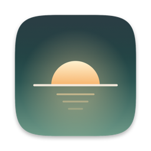

# Dayline



轻量的 macOS 菜单栏时钟。菜单栏只显示一行：

```
10月23日 周五 09:30
Fri Oct 23 09:30
```

- 可选显示时区（如 `Asia/Shanghai`、`America/New_York`），日期、星期、时间都按该时区计算，夏令时由系统时区数据库处理。
- 显示时区独立于系统时区，不修改系统的日期、时间或时区。默认跟随系统，可随时切回。
- 可分别显示或隐藏日期、星期，12／24 小时制，设置会被记住。
- 中文／英文界面，默认跟随系统语言，也可在菜单里单独指定。
- 三种可叠加的菜单栏样式：突出时间、宽字距、数字滚动。
- 可选的桌面小组件：屏幕中央显示大号星期、日期和时间，透明且不挡鼠标。
- 开机启动（系统登录项）。
- 内置更新器，从 GitHub Releases 安装经过签名校验的新版本。
- 纯 Swift + AppKit／SwiftUI，无第三方依赖。只在每个整分钟刷新一次。
- 电脑唤醒、屏幕唤醒、切回用户、系统校时后立即刷新。

## 安装

需要 macOS 14 或更高版本，Apple 芯片和 Intel 都可以。

1. 从 [Releases](https://github.com/fancyecho/Dayline/releases/latest) 下载 `Dayline.zip`，解压后把 `Dayline.app` 拖进“应用程序”文件夹。
2. 第一次打开时，macOS 会提示无法验证开发者（Dayline 没有付费的 Apple 开发者签名）。点“完成”，然后到“系统设置 › 隐私与安全性”，在页面下方点“仍要打开”。也可以在终端里执行：

   ```bash
   xattr -dr com.apple.quarantine /Applications/Dayline.app
   ```

开机启动登记的是 App 当前所在的位置，所以请先移到“应用程序”文件夹再打开“开机启动”。如果系统要求批准，按提示到“系统设置 › 通用 › 登录项”中允许。

> 菜单栏图标太多时，macOS 会把放不下的项目藏到刘海后面或被菜单栏管理工具折叠。看不到 Dayline 时，按住 ⌘ 拖动其他图标腾出位置。

## 使用

点击菜单栏上的时间：

- **时区**：跟随系统、常用时区，以及“全部时区”中按地区分组的完整列表。
- **显示日期**／**显示星期**：都关掉时只显示 `09:30`。
- **24 小时制**：勾选为 `09:30`，取消为 `上午9:30`（英文为 `9:30 AM`）。
- **样式**（可同时打开）：
  - **突出时间**：日期星期变淡，时间加粗。
  - **宽字距**：字距拉开，英文变成大写，例如 `FRI OCT 23 09:30`。
  - **数字滚动**：每到整分钟，变化的数字向上滚动。系统开启“减弱动态效果”时不播放动画。
- **桌面小组件**：
  - **显示在屏幕中央**：在主屏幕正中显示 `THURSDAY / 22 OCT 2026 / -11:45-`。它位于壁纸之上、桌面图标之下，点击会直接穿透，所有桌面空间都能看到。关掉后窗口会被释放。
  - **小／中／大**：三档尺寸。
  - **使用英文**：默认打开，小组件始终用英文；关掉后跟随界面语言（`星期四 / 2026年10月22日`）。
  - 时区、12／24 小时制、数字滚动和菜单栏共用同一套设置。
- **语言**：跟随系统、中文、English。菜单文字和菜单栏日期格式一起切换。
- **开机启动**
- **检查更新…**：查询 GitHub 上的最新版本，有新版本时可以一键安装并重启。
- **自动检查更新**：默认关闭。打开后每天最多检查一次，只在发现新版本时提示。
- **退出 Dayline**（⌘Q）

除了检查更新，Dayline 不会联网。

## 更新的安全性

每个 Release 附带 `Dayline.zip` 和它的 Ed25519 签名 `Dayline.zip.sig`。App 内置了公钥，下载后先校验签名，校验不通过就不会安装；再核对包内的 App 标识和版本号，然后才替换自身并重启。私钥只保存在发布者的电脑上，不在仓库里。

## 小组件字体

参考设计里的星期用的是 [Anurati](https://www.dafont.com/anurati.font) 字体。Dayline 不附带这款字体；系统里装了它就会自动使用，否则使用系统自带的 Avenir Next。装好字体后，关掉再打开一次小组件即可生效。

## 开发

构建需要 Xcode（或 Swift 6 工具链）。

```bash
swift build
swift test
scripts/build-app.sh            # 生成 build/Dayline.app；UNIVERSAL=1 时同时包含 Intel 版本
swift scripts/make-icon.swift   # 重新绘制 Resources/AppIcon.icns
```

- `Sources/DaylineCore`：与界面无关的逻辑，包括菜单栏和小组件的格式化、时区列表、设置存储、版本号比较和更新签名校验。
- `Sources/Dayline`：菜单栏 App（状态栏项与样式、桌面小组件窗口、菜单、整分钟定时器、唤醒监听、登录项、更新器）。
- `Tests/DaylineCoreTests`：时区换算、夏令时切换、显示选项、中英文格式、设置持久化、版本比较和签名校验的测试。

## 发布新版本

1. 修改 `Resources/Info.plist` 中的 `CFBundleShortVersionString`（如 `1.0.1`）和 `CFBundleVersion`。
2. 写好更新说明，例如 `notes.md`。
3. 运行：

   ```bash
   scripts/release.sh --publish notes.md
   ```

   脚本会检查 App 内置公钥是否与本机私钥匹配，运行测试，构建通用版，打包并签名，然后用 `gh` 创建 `v1.0.1` Release 并上传 `Dayline.zip` 和 `Dayline.zip.sig`。已安装的 Dayline 检查更新时就会看到它。

更新签名私钥位于 `~/.config/dayline/update-signing-key`，请务必备份到安全的地方。私钥丢失后，新的版本无法通过已安装 App 的签名校验，用户只能手动下载安装。
